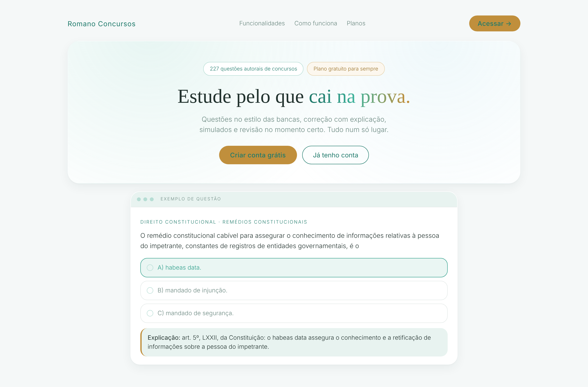
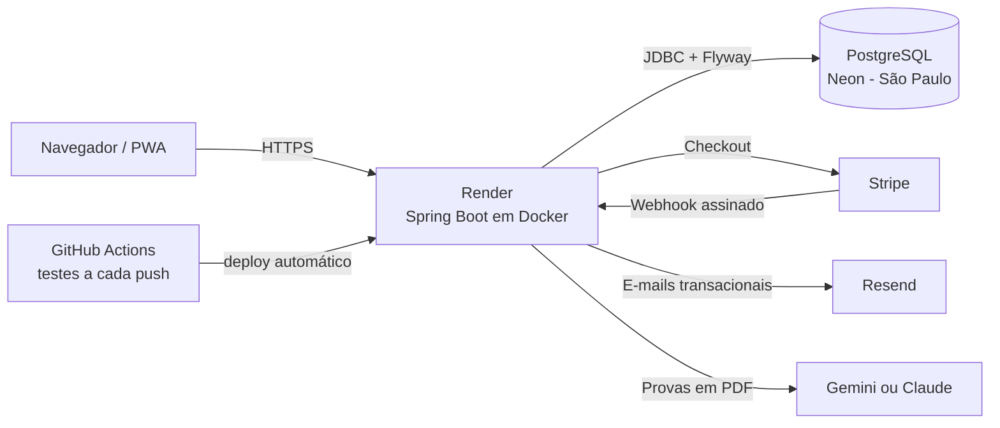
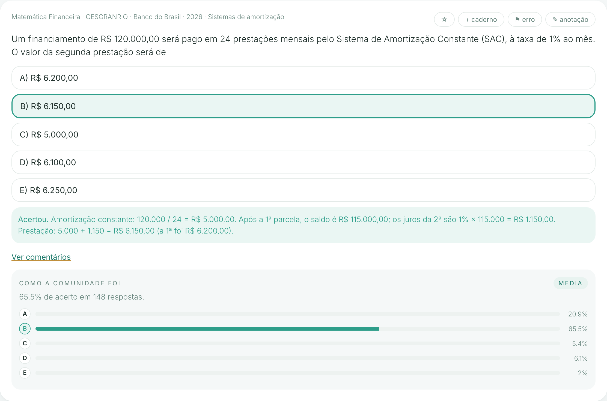
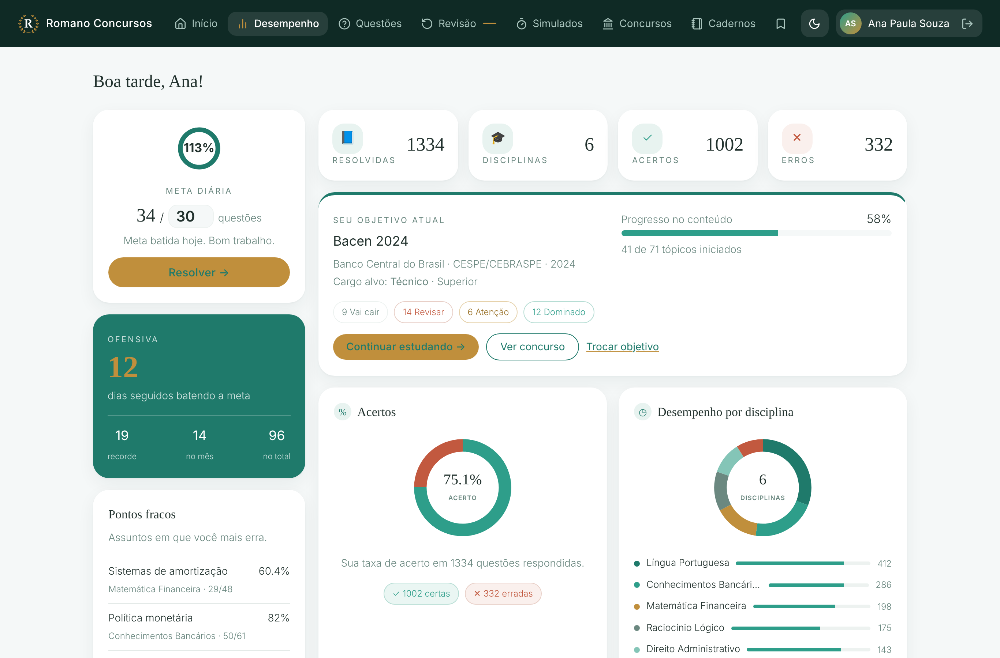
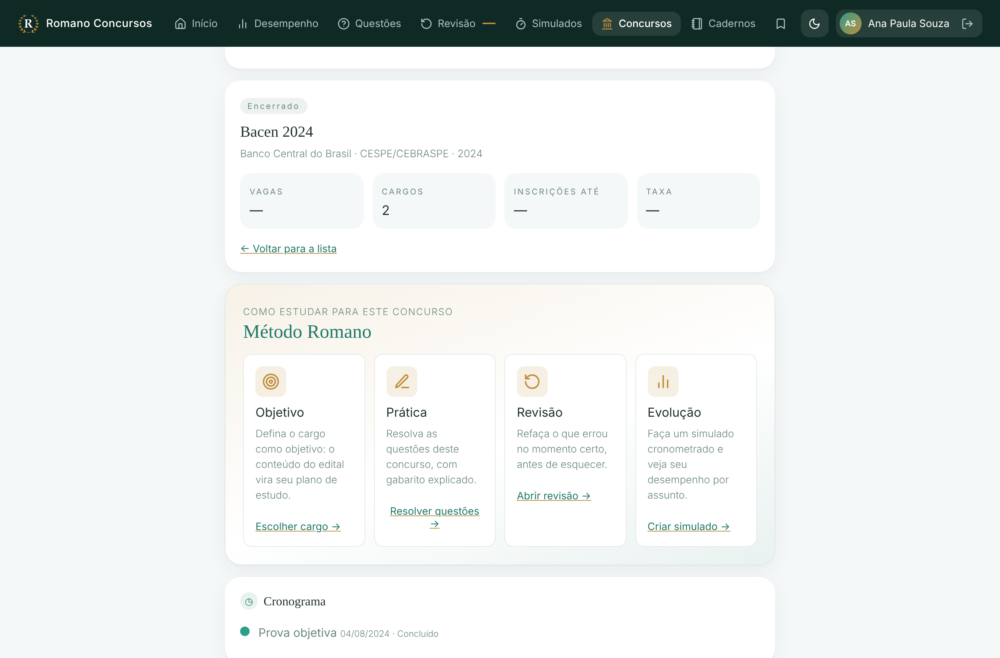
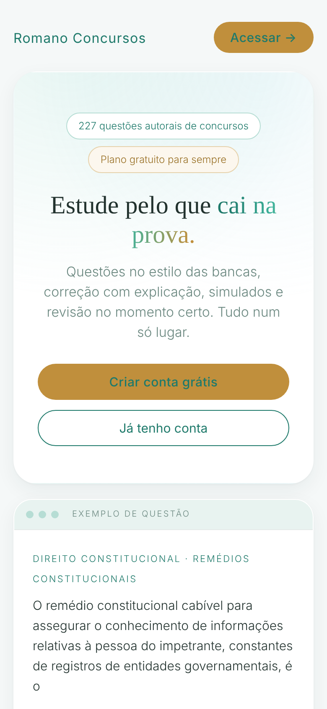

# Romano Concursos

Plataforma web de estudo para concursos públicos: banco de questões com gabarito explicado, simulados, revisão espaçada e acompanhamento de desempenho, com plano gratuito e assinatura paga.

**No ar:** [romanoconcursos.com.br](https://romanoconcursos.com.br)

> O código-fonte é privado por ser um produto comercial. Este repositório apresenta a arquitetura, as decisões técnicas e os aprendizados do projeto. Acesso de leitura ao código pode ser liberado para processos seletivos: é só pedir pelo [LinkedIn](https://www.linkedin.com/in/gustavoromanno).

---

## O que a plataforma faz

| Para quem estuda | Para a administração |
|---|---|
| Questões no estilo das bancas, múltipla escolha e Certo/Errado, com explicação do gabarito | Importação de provas em PDF com IA, gerando questões inéditas para revisão |
| Filtros em cascata: disciplina → assunto → banca → órgão → ano → concurso → cargo | Fila de revisão: aprovar, editar ou descartar cada questão gerada |
| Simulados cronometrados com resultado por disciplina | Painel com usuários, assinaturas, receita e reembolsos |
| Revisão espaçada: o que você errou volta antes de você esquecer | Catálogo de concursos com cronograma, cargos e conteúdo do edital |
| Cadernos, marcadores, anotações e comentários | E-mails promocionais só para quem consentiu (LGPD) |
| Objetivo de estudo: o edital do cargo vira um plano com progresso por disciplina | Exclusão de contas e atendimento a pedidos do titular |
| Instalável como app no celular (PWA) | |

---

## Arquitetura

- **Monólito modular** em Spring Boot: o domínio está separado em pacotes (questões, concursos, plano Pro, importação, e-mail, segurança), com front-end em HTML, CSS e JavaScript puro servido pela própria aplicação.
- **Banco versionado** com Flyway: mais de 35 migrações, incluindo os lotes de questões autorais, gerados por script de forma determinística (gerar de novo produz exatamente o mesmo arquivo, para o checksum nunca mudar).
- **Configuração só por variáveis de ambiente**: nenhuma chave no código; ambientes separados por grupos no Render.

---

## Stack

**Back-end:** Java 21 · Spring Boot 3.5 · Spring Security · JWT · Spring Data JPA · Hibernate · Flyway · Bean Validation
**Banco:** PostgreSQL (Neon) em produção · H2 nos testes
**Front-end:** HTML, CSS e JavaScript sem framework · Service Worker (PWA)
**Integrações:** Stripe (cartão, Pix e boleto) · Resend (e-mail) · Google Gemini / Anthropic Claude (IA)
**Infra:** Docker · Render · GitHub Actions · domínio próprio com DKIM e DMARC

---

## Destaques técnicos

### Pagamentos com Stripe
- Checkout hospedado pela Stripe, chamado via HTTP puro (sem SDK), com chave de acesso **restrita** à criação de sessões.
- O plano Pro só é liberado pelo **webhook**, com verificação da assinatura do evento; a página de retorno não confia no navegador.
- Pagamento confirmado, falha, expiração e **reembolso** tratados: o estorno remove o acesso automaticamente.
- Formas de pagamento definidas no painel da Stripe; o código não depende de parâmetros que a API deixou de aceitar.

### Importação de provas com IA
Um pipeline em três fases transforma a prova e o gabarito em questões inéditas:

1. **Metadados:** órgão, banca, ano, cargo e total de questões; o concurso e o cargo são vinculados ao catálogo, reaproveitando os já cadastrados.
2. **Extração:** as questões originais são transcritas em blocos e cruzadas com o gabarito definitivo (anuladas são marcadas).
3. **Geração:** para cada original, a IA cria questões inéditas do mesmo assunto e nível; um validador barra cópias da original, alternativas inválidas e referências a questões inexistentes.

Decisões de projeto:
- **Saída estruturada por "function calling"**: a IA responde sempre num esquema JSON definido pelo sistema, sem interpretar texto livre.
- **Provedor intercambiável**: uma interface comum com implementações para Gemini e Claude, escolhidas por variável de ambiente.
- **Fila assíncrona com um único worker**, para respeitar o limite de taxa da API e o pool de conexões do banco.
- **Resiliência**: novas tentativas com espera crescente, modelo reserva quando o principal está sobrecarregado e **"continuar de onde parou"**, que retoma a geração sem ler a prova de novo.
- **Revisão humana obrigatória**: nada vai ao ar sem aprovação.

### Segurança
- Autenticação com JWT e senhas com BCrypt; papéis de usuário e administrador.
- Confirmação de e-mail no cadastro e redefinição de senha com tokens de uso único, guardados só como hash.
- Bloqueio temporário após tentativas repetidas de login (por e-mail e por IP).
- Redirecionamento permanente do domínio técnico para o domínio oficial.

### LGPD e Marco Civil
- Exclusão de conta pelo próprio usuário (ou pela administração), apagando perfil e dados de estudo; pagamentos ficam sem vínculo, por obrigação fiscal.
- Apagar o histórico por categoria (respostas, simulados, cadernos, progresso).
- Consentimento explícito para e-mails promocionais, com descadastro em um clique.
- Registros de acesso (data, hora e IP) guardados por 6 meses e apagados automaticamente, como exige o Marco Civil da Internet.

### Qualidade
- **160+ testes automatizados** (integração com MockMvc e H2, além de testes de unidade), cobrindo pagamentos, importação com IA simulada, segurança, LGPD e regras de negócio.
- **CI no GitHub Actions** a cada push: testes do back-end e verificação do front-end com jsdom; o deploy só acontece depois que tudo passa.

---

## Telas

| Questão respondida | Desempenho |
|---|---|
|  |  |

| Concurso e Método Romano | No celular |
|---|---|
|  |  |

---

## O que aprendi construindo

- **Migração aplicada não se edita, e a ordem importa.** Uma migração que ficou fora do commit, enquanto a seguinte já estava em produção, teria derrubado o deploy. Passei a conferir o histórico do Flyway antes de cada versão nova.
- **Configuração também é código.** Uma variável repetida no serviço e num grupo de ambiente fez o e-mail parar sem erro aparente: o valor do serviço tinha prioridade. Os logs com mensagens claras foram o que encontrou o problema.
- **APIs externas mudam.** Um parâmetro da Stripe deixou de ser aceito; a correção foi mover a configuração para o painel e simplificar o código.
- **IA precisa de contrato e de revisão.** Esquema de saída fixo, validação automática e aprovação humana deixam a geração de conteúdo confiável.
- **Produto é mais que código:** domínio, autenticação de e-mail, termos de uso, privacidade, reembolso e atendimento fazem parte da entrega.

---

## Autor

**Gustavo Romano**: estudante de Engenharia de Software e desenvolvedor Java.
[LinkedIn](https://www.linkedin.com/in/gustavoromanno) · [GitHub](https://github.com/gustavoromanno)
